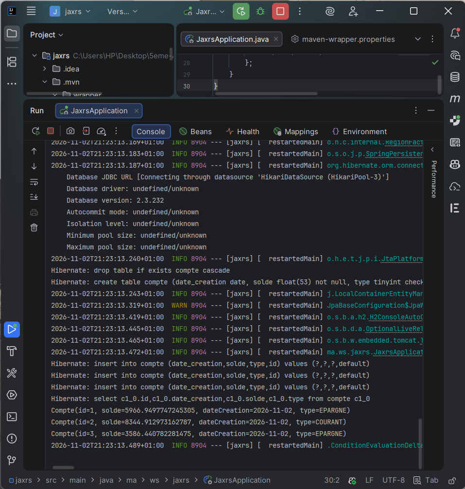
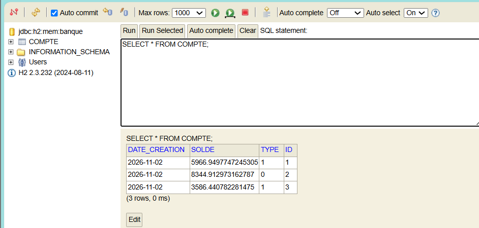
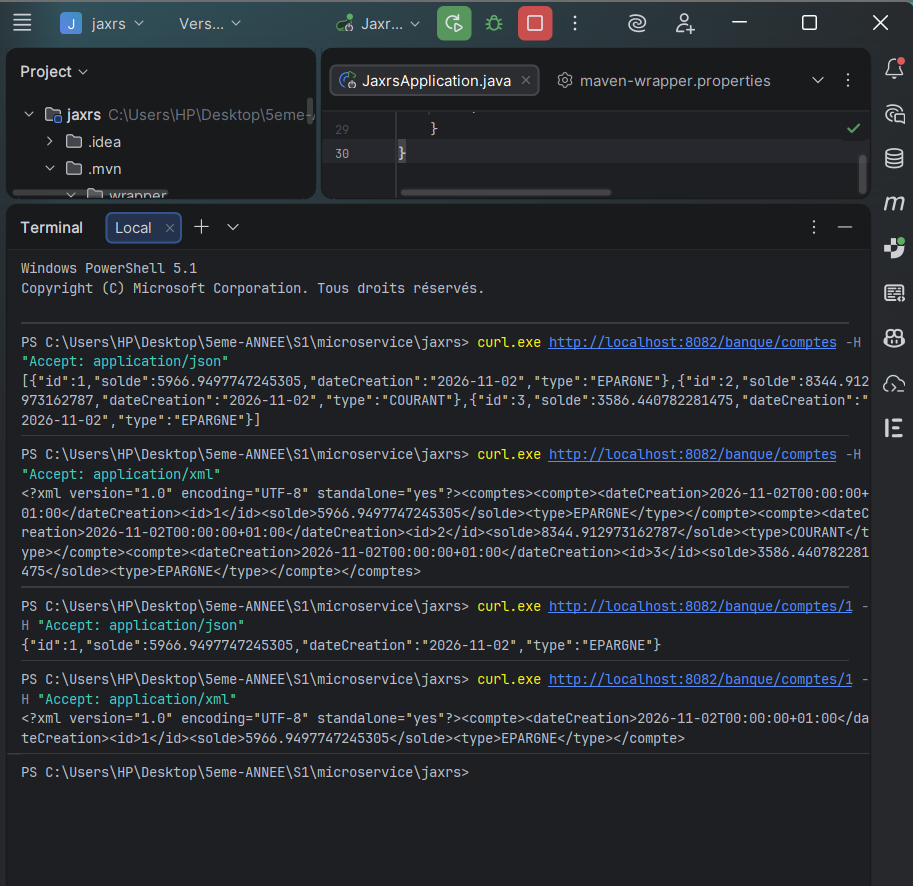
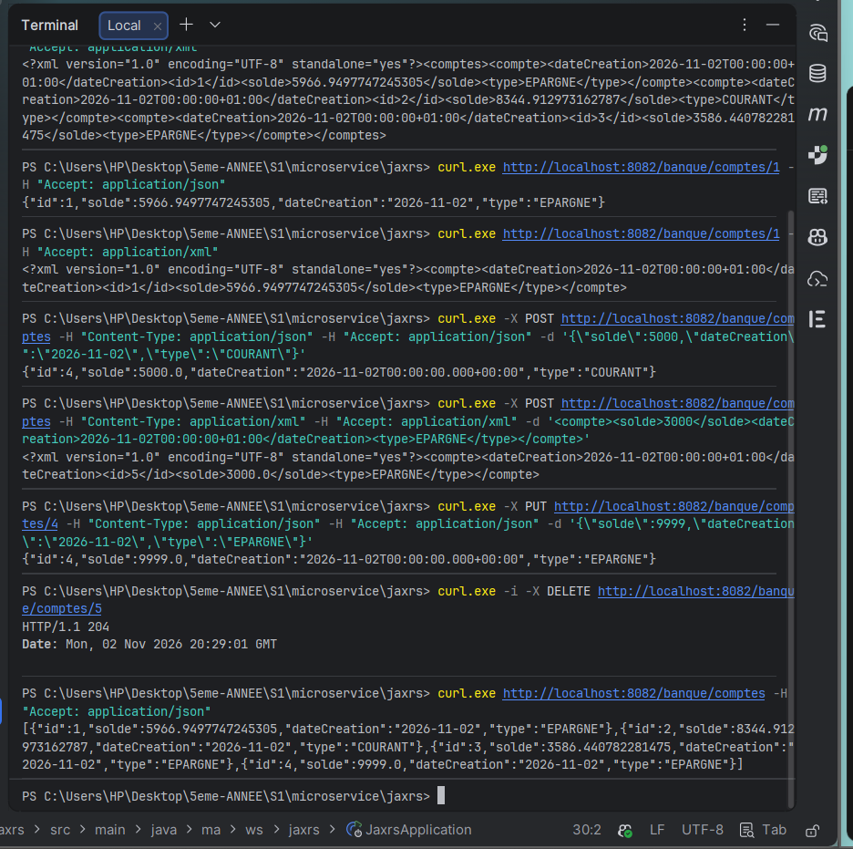

# JAX-RS avec Spring Boot : API REST de gestion des comptes bancaires

Service web **RESTful JAX-RS** (implémentation **Jersey**) intégré à **Spring Boot**, avec persistance **Spring Data JPA** dans une base **H2** en mémoire. Les mêmes endpoints répondent en **JSON** ou en **XML** selon l'en-tête `Accept` envoyé par le client.

## Objectifs

- Intégrer **Jersey (JAX-RS)** dans un projet Spring Boot via un bean `ResourceConfig`
- Créer une entité JPA `Compte` avec **Lombok** et une énumération `TypeCompte`
- Utiliser un **repository Spring Data JPA** et une base **H2** en mémoire
- Initialiser des données au démarrage avec un **`CommandLineRunner`**
- Exposer un **CRUD complet** avec les annotations JAX-RS (`@GET`, `@POST`, `@PUT`, `@DELETE`)
- Supporter **JSON et XML** grâce à `@Produces` / `@Consumes` et à **JAXB** (`@XmlRootElement`)

## Technologies

| Outil | Version |
|---|---|
| Java (JDK) | 17+ (exécuté avec JDK 23) |
| Spring Boot | 3.5.7 |
| Jersey (JAX-RS) | via `spring-boot-starter-jersey` |
| Spring Data JPA / Hibernate | via `spring-boot-starter-data-jpa` |
| H2 Database | 2.3.x (en mémoire) |
| JAXB (XML) | `jakarta.xml.bind-api` + `jaxb-runtime` + `jersey-media-jaxb` |
| Lombok | géré par Spring Boot |
| IDE | IntelliJ IDEA |

## Architecture

```
Client (curl / Postman / SoapUI)
        │  HTTP  —  Accept: application/json  ou  application/xml
        ▼
Jersey (ResourceConfig dans MyConfig)
        │
        ▼
CompteRestJaxRSAPI   →  ressource JAX-RS  (@Path("/banque"))
        │
        ▼
CompteRepository     →  JpaRepository<Compte, Long>
        │
        ▼
H2 en mémoire : base banque, table COMPTE
```

## Structure du projet

```
jaxrs
├── pom.xml
├── screenshots/
└── src/main
    ├── java/ma/ws/jaxrs
    │   ├── JaxrsApplication.java          # main + CommandLineRunner (3 comptes)
    │   ├── config/MyConfig.java           # bean ResourceConfig (Jersey)
    │   ├── controllers/CompteRestJaxRSAPI.java
    │   ├── entities/Compte.java           # @Entity + @XmlRootElement + Lombok
    │   ├── entities/TypeCompte.java       # enum COURANT / EPARGNE
    │   └── repositories/CompteRepository.java
    └── resources/application.properties
```

## Entité `Compte`

| Attribut | Type | Détail |
|---|---|---|
| `id` | `Long` | Clé primaire auto-incrémentée (`IDENTITY`) |
| `solde` | `double` | Solde du compte |
| `dateCreation` | `Date` | `@Temporal(TemporalType.DATE)` |
| `type` | `TypeCompte` | `COURANT` ou `EPARGNE`, stocké avec `@Enumerated(EnumType.ORDINAL)` |

Avec `EnumType.ORDINAL`, la colonne `TYPE` contient la **position** de la constante : `COURANT = 0` et `EPARGNE = 1`. L'API la reconvertit en texte.

## Endpoints

Base URL : `http://localhost:8082/banque`

| Méthode | Endpoint | Description | Formats |
|---|---|---|---|
| GET | `/comptes` | Liste de tous les comptes | JSON / XML |
| GET | `/comptes/{id}` | Un compte par son id | JSON / XML |
| POST | `/comptes` | Créer un compte | JSON / XML |
| PUT | `/comptes/{id}` | Modifier un compte | JSON / XML |
| DELETE | `/comptes/{id}` | Supprimer un compte (204 No Content) | — |

Le format de la réponse est choisi par l'en-tête `Accept`, et celui du corps envoyé par l'en-tête `Content-Type`.

## Configuration (`application.properties`)

```properties
server.port=8082
spring.datasource.url=jdbc:h2:mem:banque
spring.datasource.username=sa
spring.datasource.password=
spring.h2.console.enabled=true
spring.jpa.show-sql=true
```

## Lancer le projet

1. Ouvrir le projet dans IntelliJ et recharger Maven.
2. Lancer `JaxrsApplication`. Trois comptes sont créés automatiquement.
3. Console H2 : **http://localhost:8082/h2-console** (JDBC URL `jdbc:h2:mem:banque`, user `sa`, sans mot de passe).
4. Tester l'API, par exemple dans PowerShell :

```bash
# Lecture JSON / XML
curl.exe http://localhost:8082/banque/comptes -H "Accept: application/json"
curl.exe http://localhost:8082/banque/comptes -H "Accept: application/xml"
curl.exe http://localhost:8082/banque/comptes/1 -H "Accept: application/xml"

# Création (JSON puis XML)
curl.exe -X POST http://localhost:8082/banque/comptes -H "Content-Type: application/json" -H "Accept: application/json" -d '{\"solde\":5000,\"dateCreation\":\"2026-11-02\",\"type\":\"COURANT\"}'
curl.exe -X POST http://localhost:8082/banque/comptes -H "Content-Type: application/xml" -H "Accept: application/xml" -d '<compte><solde>3000</solde><dateCreation>2026-11-02T00:00:00+01:00</dateCreation><type>EPARGNE</type></compte>'

# Modification et suppression
curl.exe -X PUT http://localhost:8082/banque/comptes/4 -H "Content-Type: application/json" -H "Accept: application/json" -d '{\"solde\":9999,\"dateCreation\":\"2026-11-02\",\"type\":\"EPARGNE\"}'
curl.exe -i -X DELETE http://localhost:8082/banque/comptes/5
```

## Corrections apportées à l'énoncé

| Problème dans l'énoncé | Correction |
|---|---|
| Imports `javax.persistence` / `javax.xml.bind` / `javax.ws.rs` | `jakarta.*` (obligatoire depuis Spring Boot 3 / Jakarta EE 9+) |
| Spring Boot 4.x proposé par Initializr : le support Jersey y a été retiré puis rétabli sans Jackson 3 | Projet basé sur **Spring Boot 3.5.7**, compatible Jersey 3 + Jackson 2 |
| Versions fixées à la main pour JAXB et `jersey-media-jaxb` (risque de conflit) | Versions gérées par le BOM Spring Boot |
| Lombok non pris en compte avec JDK 23 (traitement des annotations désactivé par défaut) | Lombok déclaré dans `annotationProcessorPaths` du `maven-compiler-plugin` |
| Console H2 indiquée sur le port 8080 | Le serveur tourne sur **8082** : `http://localhost:8082/h2-console` |
| `@Produces` sur le `DELETE` qui ne renvoie rien | Annotation retirée (réponse **204 No Content**) |

## Résultats

### 1. Démarrage : 3 comptes initialisés par le `CommandLineRunner`


### 2. Console H2 : table `COMPTE` (type stocké en ordinal : 0 = COURANT, 1 = EPARGNE)


### 3. Lecture en JSON et en XML (liste et compte par id)
La même URL renvoie du JSON ou du XML selon l'en-tête `Accept`.



### 4. CRUD : POST (JSON et XML), PUT, DELETE (204) puis liste finale


Après un POST ou un PUT, la date est renvoyée avec l'heure (`java.util.Date` reçu). Après une lecture, Hibernate renvoie un `java.sql.Date` (format `yyyy-MM-dd`).

## Ce que j'ai appris

- Intégrer **Jersey (JAX-RS)** dans Spring Boot avec un bean `ResourceConfig`
- Différencier les annotations **JAX-RS** (`@Path`, `@GET`, `@PathParam`, `@Produces`, `@Consumes`) des annotations Spring MVC
- Faire de la **négociation de contenu** JSON / XML avec l'en-tête `Accept`
- Sérialiser en XML avec **JAXB** (`@XmlRootElement`)
- Réduire le code répétitif avec **Lombok** (`@Data`, `@NoArgsConstructor`, `@AllArgsConstructor`)
- Utiliser une base **H2** en mémoire et sa console web
- Comprendre la différence entre `EnumType.ORDINAL` et `EnumType.STRING`

## Auteur

**Hibatalah Hamrani**, cycle ingénieur DSI, EMSI Marrakech
Cours : *Frameworks et architecture microservices*